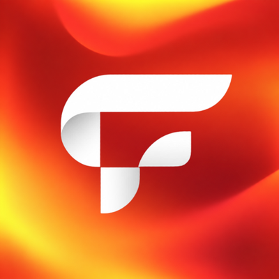

<p align="center">
  
</p>

# Flashloop MCP server

[](https://lobehub.com/mcp/la-viral-studio-flashloop-mcp-server)

Create AI videos, images and voiceovers from your AI assistant with your [Flashloop](https://www.flashloop.ai) account.

Flashloop is a hosted (remote) MCP server. There is nothing to install or run: add the URL below to any MCP client
that supports remote servers and sign in with your Flashloop account.

| | |
|---|---|
| Server URL | `https://mcp.flashloop.ai/mcp` |
| Transport | Streamable HTTP |
| Authentication | OAuth 2.1 (sign in with your Flashloop account in the browser) |
| Docs | https://www.flashloop.ai/mcp |

This repository holds the public documentation and registry metadata for the server. The server itself is
operated by La Viral Studio and its source code is not public.

## What you can do

- Generate short videos from a text prompt or a reference image, with control over length, aspect ratio,
  resolution and sound on models that support them.
- Create up to 4 images per prompt.
- Keep characters, places and props consistent across a series with saved references.
- Turn a script into a voiceover in more than 70 languages, change the voice of existing audio, or translate spoken
  audio while keeping the voice.
- Clone your own voice and use it in voiceovers.
- Upscale existing images and videos 2x or 4x.
- Assemble clips and voiceovers into one captioned video.
- Browse, download and delete your past generations.
- Check your credit balance or estimate a job before you start.

Everything you make is saved to your Flashloop library at [flashloop.app](https://flashloop.app). Generations use
your Flashloop credits. Prompts and uploads go through Flashloop's content moderation.

## Connect

You need a Flashloop account. The first time a client connects, it opens a browser window to sign in.

### Claude (claude.ai and Claude Desktop)

Settings > Connectors > Add custom connector, then paste `https://mcp.flashloop.ai/mcp`.

### Claude Code

```sh
claude mcp add --transport http flashloop https://mcp.flashloop.ai/mcp
```

### Cursor

Add to `~/.cursor/mcp.json`:

```json
{
  "mcpServers": {
    "flashloop": {
      "url": "https://mcp.flashloop.ai/mcp"
    }
  }
}
```

### VS Code

Add to `.vscode/mcp.json`:

```json
{
  "servers": {
    "flashloop": {
      "type": "http",
      "url": "https://mcp.flashloop.ai/mcp"
    }
  }
}
```

### Cline

Add to Cline's MCP settings (`cline_mcp_settings.json`):

```json
{
  "mcpServers": {
    "flashloop": {
      "type": "streamableHttp",
      "url": "https://mcp.flashloop.ai/mcp"
    }
  }
}
```

### Other clients

Any client that supports remote MCP servers over Streamable HTTP with OAuth works: use
`https://mcp.flashloop.ai/mcp` as the server URL.

## Example prompts

- "Make a 5-second video of waves crashing on a beach at sunset."
- "Create 4 images of a cozy coffee shop interior."
- "How many Flashloop credits do I have?"

## Links

- Website: https://www.flashloop.ai
- Support: https://www.flashloop.ai/contact
- Privacy policy: https://www.flashloop.ai/privacy
- Terms of service: https://www.flashloop.ai/terms
